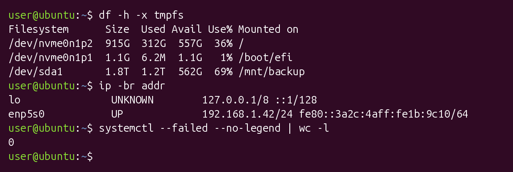
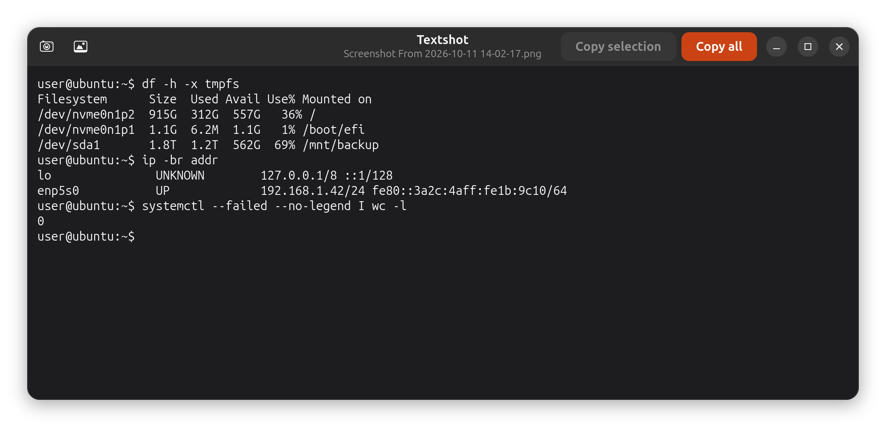
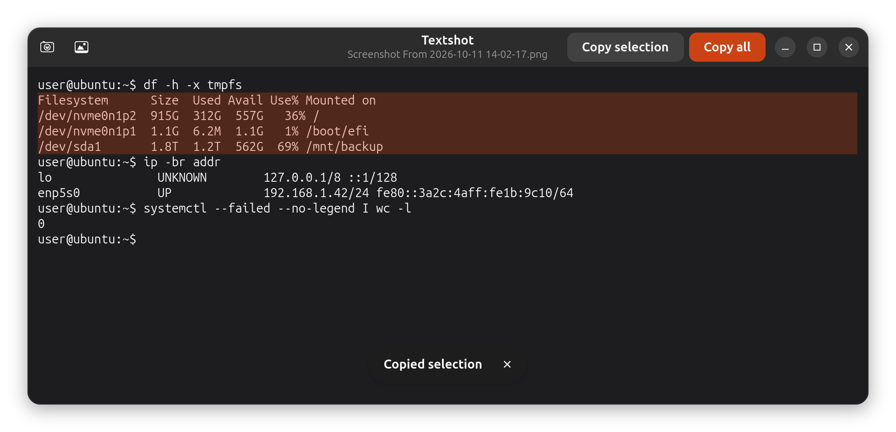

# Textshot

Grab text from anywhere on your screen on Ubuntu / GNOME.

Textshot opens GNOME's own screenshot picker. You drag a box around some
text, and Textshot reads it (OCR) and shows it in a window. Select any part
of it and copy, or copy all of it at once. The screenshot is kept in your
normal `Pictures/Screenshots` folder, like any other screenshot.

It works well on terminals, logs, error dialogs, tables and anything else
you can see but can't select.

| Captured area | What Textshot gives you |
| --- | --- |
|  |  |

Select just the lines you want and press **Ctrl+C** or **Copy selection**:



## Features

- **Uses the normal GNOME screenshot UI.** It's the same picker you get with
  Print Screen, through the screenshot portal, so it works on Wayland.
- **Accurate OCR, even on terminal fonts.** It uses
  [RapidOCR](https://github.com/RapidAI/RapidOCR) (PaddleOCR models on ONNX
  Runtime), which runs locally on the CPU and doesn't need a GPU or internet
  access. Plain Tesseract often misreads terminal fonts, for example `0` as
  `®`.
- **Keeps the layout.** Lines, blank lines and table columns are rebuilt from
  word positions, so `df`, `lsblk` or `ps` output still lines up.
- **Copy what you want.** Highlight part of the text and copy it, or use
  *Copy all*. You can also edit the text first. The clipboard keeps the text
  after Textshot closes.
- **Keeps the screenshot** in `~/Pictures/Screenshots` with GNOME's usual
  `Screenshot From YYYY-MM-DD HH-MM-SS.png` name. The image button opens it.
- **Reads existing images too.** Run `textshot image.png`, or right-click an
  image in Files and choose *Open With → Textshot*.

## Install

Textshot needs GNOME on Wayland (tested on Ubuntu 26.04, GNOME 50) and
Python 3.

```bash
sudo apt install python3-gi gir1.2-gtk-4.0 gir1.2-adw-1 python3-venv wl-clipboard
git clone https://github.com/ssjrocks/textshot.git
cd textshot
./install.sh --desktop
```

The installer puts everything in your home folder (no root needed):

| What | Where |
| --- | --- |
| App and its Python environment | `~/.local/share/textshot/` |
| `textshot` command | `~/.local/bin/textshot` |
| App grid entry | `~/.local/share/applications/io.github.ssjrocks.Textshot.desktop` |
| Desktop launcher (with `--desktop`) | `~/Desktop/` |

Run `./install.sh` again to update. Run `./install.sh --uninstall` to remove
it. Your screenshots are not touched.

### Keyboard shortcut (optional)

To start Textshot with **Shift+Super+T**:

```bash
P=/org/gnome/settings-daemon/plugins/media-keys/custom-keybindings/textshot/
gsettings set org.gnome.settings-daemon.plugins.media-keys custom-keybindings "['$P']"
gsettings set org.gnome.settings-daemon.plugins.media-keys.custom-keybinding:$P name 'Textshot'
gsettings set org.gnome.settings-daemon.plugins.media-keys.custom-keybinding:$P command "$HOME/.local/bin/textshot"
gsettings set org.gnome.settings-daemon.plugins.media-keys.custom-keybinding:$P binding '<Shift><Super>t'
```

That replaces any custom shortcuts you already have. If you have some, add it
in *Settings → Keyboard → Keyboard Shortcuts → Custom Shortcuts* instead.

## Usage

1. Start **Textshot** from the app grid, the desktop icon or your shortcut.
2. Drag a box around the text in the screenshot picker and press **Enter**
   (or click the capture button). Press **Esc** to cancel.
3. The text appears after a second or two.

| Key | Action |
| --- | --- |
| Ctrl+C | Copy the selected text |
| Ctrl+Shift+C | Copy all text |
| Ctrl+N | Capture another area |
| Esc | Close |

```text
textshot            capture an area of the screen
textshot IMAGE      read text from an existing image file
```

## Notes

- OCR is very good but not perfect. Characters that look alike can get
  mixed up, for example `|` read as `I`, or a lowercase letter read as a
  capital. The text is editable, so you can fix things before copying.
- It uses the default English/Chinese PaddleOCR models that ship with
  RapidOCR.
- Textshot uses about 500 MB of RAM while it is open and nothing once it is
  closed.

## Development

`textshot.py` is the whole app, a GTK 4 / libadwaita application. To
regenerate the README images:

```bash
~/.local/share/textshot/venv/bin/python tools/make_screenshots.py
```

That script draws the sample terminal image, opens Textshot on it, and renders
the window to `docs/screenshots/`.

## License

MIT, see [LICENSE](LICENSE).
